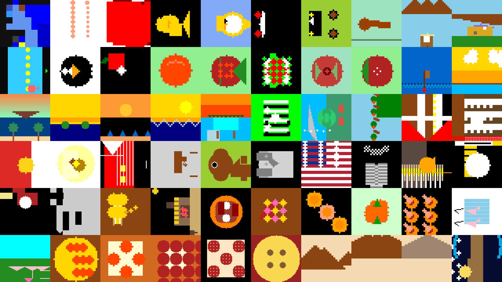

# Autoregressive Mosaics

**Probing 2D Spatial Reasoning in Text-Only Language Models**

Ashwin Nedungadi · Stefan Oehmcke · Stefan Lüdtke

Institute for Visual & Analytic Computing (VAC), University of Rostock

**WACV 2027** · Exhibited at the **[CVPR 2026 Art Gallery](https://thecvf-art.com/project.php?year=2026&artist=ashwin-nedungadi&id=933)** (Denver) and the **[ECCV 2026 Art Gallery](https://eccv-art-26.github.io/)** (Malmö)

[Project page](https://ashwin-ned.github.io/autoregressive-mosaics/) · [Paper (arXiv)](https://arxiv.org/abs/2608.30751) · [Poster](assets/Autoregressive_Mosaics_A0.pdf) · [Video](https://www.youtube.com/watch?v=9_7Cmhajiko) · [Live demo](https://huggingface.co/spaces/ashnedungadi/AutoregressiveMosaics)



## AM-Bench

How well can text-only language models compose 2D layouts, how does the output medium affect this ability, and what spatial information do they represent before drawing?

AM-Bench separates two tasks on a deterministic 24 × 24 canvas, where models write Python using six primitives (`fill`, `set_pixel`, `rect`, `circle`, `line`, `poly`):

- **Translation (control):** turn fully specified geometry into drawing code. Outputs are scored symbolically against exact references with part-wise intersection-over-union (PIoU); a model enters the layout comparison only if its median PIoU clears a pre-registered gate of 0.6.
- **Layout (target):** compose an arrangement from an underspecified prompt. Two VLM judges (Qwen2.5-VL-7B, InternVL3-8B) score prompt fidelity, shape, color, spatial accuracy, and completeness on a 0–5 scale.

The study evaluates eight open-weight models (8B–34B) from four families on 150 layout prompts in three tiers (elemental, iconic, compositional; 15 subcategories), for 13,200 layout and 13,920 translation attempts.

## Findings

- **Geometry is easier than composition.** All eight models reach a median translation PIoU of 1.000 (random baseline 0.072), yet mean layout scores range from 1.75 to 3.57 (Judge 1). Both judges give the same model ranking (ρ = 1.0).
- **The medium matters.** Raw SVG improves the pooled layout score over the custom Python API by +0.37 on the 0–5 scale at matched resolution (95% CI [0.26, 0.47]); every model improves.
- **A coarse layout is decodable before generation.** Residual-stream probes beat a text baseline in all eight models (mean ΔR² = +0.164). A two-model decomposition recovers layout structure shared across models but not model-specific layouts, and editing the first drawn shape changes what follows (continuation rate 43.8% → 84.6% for GLM-4 32B, 2.5% → 41.2% for Gemma 2 27B), consistent with incremental construction rather than a fixed advance plan.

These findings concern coarse, code-generated images and judge-dependent scores. See the paper for evaluation details, controls, and limitations.

## Repository

This repository hosts the project website and the prototypes exhibited at the CVPR 2026 and ECCV 2026 Art Galleries. The gallery and demo are prototype outputs, separate from the paper's benchmark evaluation. AM-Bench code, prompts, and generations will be released via the project page.

- `index.html`, `style.css`, `main.js`: project website.
- `assets/`: poster, AM-Bench sample outputs, social preview image.
- `gallery_images/`, `results/`: prototype outputs and visual assets.
- `ver2-asciicanvas/`: ASCII grid and color-palette prototype.
- `ver3-codecanvas/`: Python drawing-code prototype.

Both prototypes use `Qwen/Qwen2.5-14B-Instruct`; this is distinct from the paper's eight-model benchmark roster.

## Run locally

Preview the static website:

```bash
python -m http.server 8000
```

Open `http://localhost:8000`.

To run a prototype, use Python 3.10+ and a suitable GPU for the 14B model:

```bash
pip install fastapi uvicorn torch transformers accelerate
cd ver2-asciicanvas  # or ver3-codecanvas
python backend.py
```

Open `http://localhost:8123`. Run one prototype at a time; both use the same port.

## Citation

```bibtex
@inproceedings{nedungadi2027autoregressivemosaics,
  title     = {Autoregressive Mosaics: Probing 2D Spatial Reasoning in Text-Only Language Models},
  author    = {Nedungadi, Ashwin and Oehmcke, Stefan and L{\"u}dtke, Stefan},
  booktitle = {Proceedings of the IEEE/CVF Winter Conference on Applications of Computer Vision (WACV)},
  year      = {2027}
}
```

## Copyright and License

**Copyright © 2026 Ashwin Nedungadi. All Rights Reserved.**

This code is provided for viewing purposes only, in conjunction with the paper and the CVPR 2026 and ECCV 2026 Art Gallery exhibits. Copying, modification, distribution, and derivative works without citation are prohibited.
